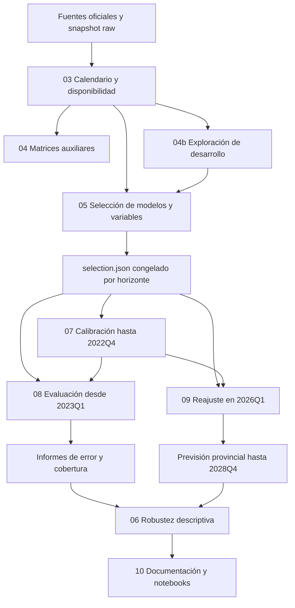

# Conexión de las dos fases

La fase 1 identifica una especificación por horizonte; la fase 2 la aplica tras verificarla y calibrar su incertidumbre. El archivo `selection.json` vincula ambas fases mediante su identificador de contenido.

## Fase 1: aprender qué funciona en desarrollo

El panel conserva todos los trimestres y no interpola precios ausentes. Las fuentes externas se alinean con sus retrasos supuestos antes de calcular ratios. El análisis exploratorio informa cobertura, asociaciones y redundancia. Las correlaciones no sustituyen la prueba predictiva.

La búsqueda compara modelos y conjuntos de variables usando cuatro fechas objetivo históricas. Un cribado a 1, 4, 8 y 12 trimestres limita el coste. Cuatro finalistas de familias distintas compiten con todas las referencias en los doce horizontes. Se congela la mejor especificación de cada horizonte.

## Fase 2: evaluar y aplicar lo seleccionado

La calibración usa exclusivamente el periodo anterior a 2023. La evaluación mide los modelos congelados con datos posteriores y referencias bajo el mismo contrato de origen. Un resultado desfavorable se mantiene visible y no causa una selección encubierta.

La previsión final ajusta esos mismos modelos con etiquetas conocidas en 2026Q1. Los modelos directos reciben las variables observadas del origen y producen cada horizonte sin introducir variables externas futuras. Si un horizonte seleccionó la referencia recursiva, sus valores intermedios son predicciones, nunca precios reales futuros.

El resultado contiene provincia, origen, trimestre previsto, horizonte, modelo, bloque, identificador de selección, predicción y bandas. Los manifiestos y auditorías relacionan las cifras con la selección y con el conjunto de datos.

## Lectura de artefactos

| Necesidad | Artefacto |
| --- | --- |
| Saber qué modelo y variables se eligieron | `data/reports/unified/selection.json` y `selected_models.csv` |
| Revisar la parrilla completa | `candidate_grid.json`, `screening_metrics.csv` |
| Ver el aporte de bloques | `feature_block_contribution.csv` |
| Examinar errores recientes | `evaluation_metrics.csv`, `evaluation_province.csv`, `evaluation_origin.csv` |
| Comparar horizontes en los mismos orígenes | `evaluation_balanced_metrics.csv` |
| Revisar incertidumbre y cobertura | `interval_calibration.csv`, `interval_coverage.csv` |
| Ver sensibilidad | `robustness_*.csv` y `forecast_trajectory_diagnostics.csv` |
| Consultar el pronóstico | `data/forecasts/prevision_provincial_2026T2_2028T4.csv` |

Los archivos relativos sin prefijo de la tabla están en `data/reports/unified`. Los cuadernos activos solo leen el flujo vigente.
